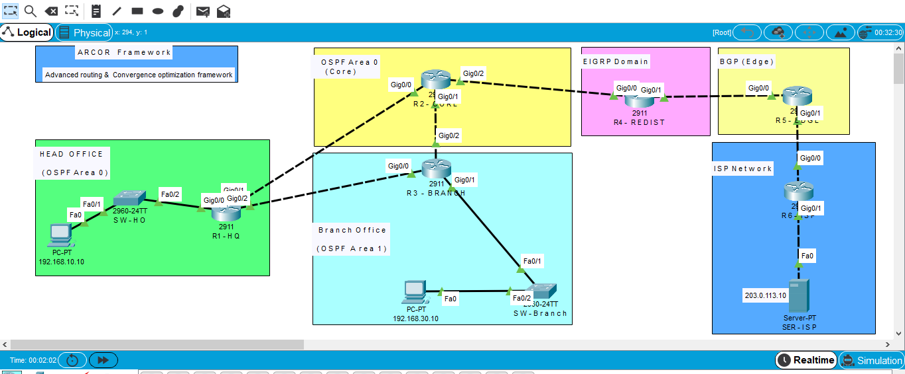
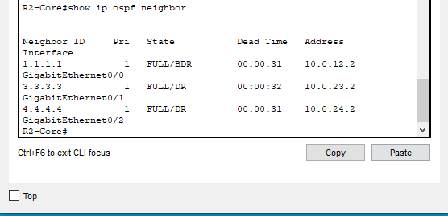
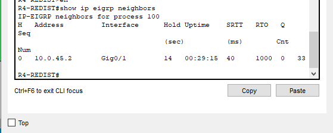
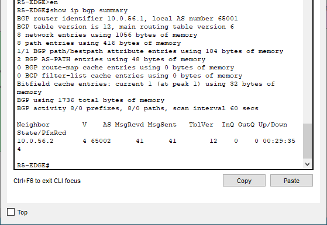
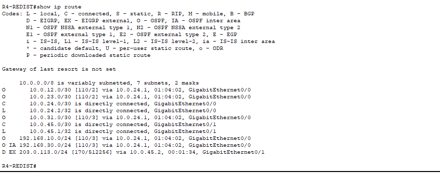
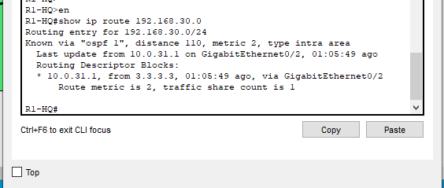

# ARCOR Framework
## Advanced Routing & Convergence Optimization Framework

### Overview

ARCOR is an enterprise networking framework designed to demonstrate advanced dynamic routing, route redistribution, network redundancy, and automatic recovery from link failures.

### Network Architecture

The network includes six routers, two switches, two PCs, and one ISP server.

| Device | Role |
|---|---|
| R1-HQ | Headquarters Router |
| R2-CORE | Core Router |
| R3-BRANCH | Branch Router |
| R4-REDIST | Redistribution Router |
| R5-EDGE | Enterprise Edge Router |
| R6-ISP | ISP Router |
| SW-HQ | Headquarters Switch |
| SW-BRANCH | Branch Switch |
| PC-HQ | Headquarters Client |
| PC-BRANCH | Branch Client |
| SRV-ISP | ISP Server |

📄 

### Routing Technologies

*OSPF Multi-Area*
- Area 0 and Area 1
- Dynamic routing
- Alternate path selection

*EIGRP*
- Autonomous System 100
- Dynamic route exchange
- OSPF route redistribution

*BGP*
- External BGP (eBGP)
- Enterprise AS 65001
- ISP AS 65002

### Route Redistribution

- OSPF to EIGRP
- EIGRP to BGP
- BGP to EIGRP
- EIGRP to OSPF

### Failover & Recovery

A redundant link connects headquarters and branch routers.

During testing:
- The direct R1-HQ to R3-BRANCH link was disabled.
- OSPF selected an alternate path through R2-CORE.
- PC-HQ successfully communicated with PC-BRANCH.
- The original link was restored.
- OSPF selected the preferred direct path again.

### Verification

- Router connectivity
- OSPF neighbor verification
- EIGRP routing verification
- BGP peering verification
- Route redistribution
- HQ-to-ISP connectivity
- Branch-to-ISP connectivity
- Failover and recovery testing

### Tools & Technologies

- Cisco Packet Tracer
- Cisco IOS CLI
- OSPF
- EIGRP
- BGP
- Dynamic Routing
- Route Redistribution
- Network Redundancy
## Practical Lab Screenshots

### 1. OSPF Neighbor Verification

### 2. EIGRP Neighbor Verification

### 3. BGP Peering Verification

### 4. Route Redistribution

### 5. OSPF Failover & Recovery

### Conclusion

ARCOR demonstrates the integration of multiple dynamic routing protocols to build a resilient enterprise network with automatic recovery from link failures.
